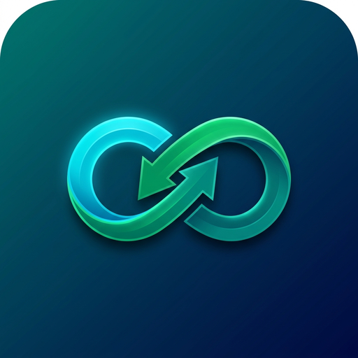

<p align="center">
  
</p>

<h1 align="center">SkillSwap</h1>

<p align="center">
  <strong>Student Peer-to-Peer Campus Skill Exchange Platform</strong><br>
  <em>"Teach One Skill. Learn Another. Grow Together."</em>
</p>

<p align="center">
  
  
  
  
  
  
</p>

---

## 📖 Overview

**SkillSwap** is a mobile application tailored for college campuses that enables students to discover, connect, and trade skills with peers without monetary transactions.

Instead of paying for third-party courses, a computer science student proficient in **Figma** can match with an IT student who teaches **Photography** or **Cybersecurity**. Through an intelligent bidirectional compatibility matching engine, students exchange knowledge, coordinate learning sessions via real-time 1-on-1 chat with image sharing, and build verified academic reputations via peer ratings.

---

## 📱 Releases & APK Download

You can download the production-ready Android APK directly:

- **Latest Release on GitHub:** [Releases Page](https://github.com/AlshahithFayaz/SkillSwap2/releases)
- **Direct APK Binary:** `SkillSwap-v1.0.0.apk`
- **Minimum Android Version:** Android 6.0 (API Level 23+)
- **Target Android Version:** Android 14+ (API Level 34)

### 📲 Installing on Your Android Phone
1. Download `SkillSwap-v1.0.0.apk` onto your Android device or transfer it via USB.
2. Tap the APK file to install (allow *"Install from unknown sources"* if prompted).
3. Open **SkillSwap** and log in or register with your college email.

---

## ✨ Key Features

### 🎯 1. Smart Compatibility Matching Engine
Implements a mathematical matching algorithm calculating bidirectional peer compatibility scores:

$$\text{Score} = \left(\frac{|\text{Teach}_A \cap \text{Learn}_B|}{|\text{Learn}_B|} \times 0.5\right) + \left(\frac{|\text{Teach}_B \cap \text{Learn}_A|}{|\text{Learn}_A|} \times 0.5\right)$$

- **Mutual Match (70–100%):** Both students teach what the other wants to learn.
- **One-Way High Match (50–69%):** Strong overlap in one direction with complementary interests.
- **Partial Match (25–49%):** Overlapping domain interests.
- **Real-Time Feed Sorting:** Candidates dynamically sorted from highest to lowest compatibility score.

### ⚡ 2. User-Friendly Skill Management
- **Segmented 2-Tab View:** Separate panels for **"I Can Teach"** and **"I Want to Learn"** with real-time selection counters.
- **Domain Categories:** Quick filtering pills (*Tech & Coding*, *Design & Creative*, *Data & AI*, *Core & Communication*).
- **1-Tap Toggling:** Tap any standard chip to add or remove instantly.
- **Custom Skill Creation:** Create and save any custom skill on the fly.
- **Profile Deep-Linking:** Direct navigation from profile edit buttons into the exact skill editing section.

### 🤝 3. Exchange Lifecycle & Request Management
- **Connect & Swap:** Initiate swap requests with prospective peers.
- **Status Gatekeeping:** Clear separation between `Pending`, `Accepted`, and `Rejected` requests.
- **Real-Time Multi-Device Sync:** Firestore-backed state synchronization updates partner cards across devices automatically.

### 💬 4. 1-on-1 Chat with Instant Image Sharing
- **Unlocked Upon Acceptance:** Chat activates automatically when both students accept a swap.
- **📸 Image Sharing (Camera & Gallery):**
  - Live photo capture via device camera.
  - Photo selection from gallery for sharing diagrams, code snippets, notes, and UI mockups.
  - Interactive fullscreen viewer with pinch-to-zoom and pan.
- **⚡ Quick Replies:** Contextual 1-tap responses (*"Tomorrow 5 PM?"*, *"This weekend works for me!"*, *"Shall we meet at the library?"*).
- **Date Separators & Read Indicators:** Grouped message timestamps with double checkmarks (`✓✓`).

### 🔔 5. Real-Time In-App Alert Banners
- **Floating Banner:** Animated top notification card slides down with sender avatar, name, and message preview when incoming messages arrive while navigating other tabs.
- **Haptic Feedback:** Tactile vibration alert upon message receipt.
- **Unread Badge Counters:** Dynamic unread badge counter displayed on the bottom navigation bar's **Chat** tab.

### ⭐ 6. Peer Ratings & Reviews
- Unlocks after session completion.
- 1–5 star rating system with qualitative review comments.
- Aggregated ratings displayed on student profile and discovery cards.

---

## 🎨 UI/UX Design System

SkillSwap is designed under strict accessibility and human-interface design standards:

| Semantic Token | Hex Code | Purpose |
| :--- | :--- | :--- |
| **Primary (Deep Teal)** | `#0D9488` | Brand anchor, primary CTAs, active highlights |
| **Teal Dark** | `#0F766E` | Header gradients, focused borders |
| **Accent (Cyan)** | `#06B6D4` | Dynamic accents, ring badges, gradients |
| **Teach (Emerald Green)** | `#16A34A` | "I Can Teach" chips, presence indicators, success |
| **Learn (Amber)** | `#D97706` | "I Want to Learn" chips, star ratings (WCAG $\ge 4.5:1$) |
| **Surface (Slate)** | `#F8FAFC` | Clean background canvas |
| **Text Primary** | `#0F172A` | Accessible high-contrast typography |

- **Touch Targets:** All interactive buttons and chips have a minimum dimension of $\ge 48\text{dp}$.
- **Typography:** Modern sans-serif hierarchy using Inter.
- **Iconography:** Vector-only icons (`Icons.*`) — zero emojis used as structural UI icons.

---

## 🏗️ Architecture & Project Structure

```
skill_swap_flutter/
├── .github/
│   └── workflows/
│       └── release.yml          # Automated CI/CD release workflow
├── android/                     # Android native configuration & icons
├── assets/
│   └── images/
│       └── app_logo.png         # Official high-resolution brand asset
├── lib/
│   ├── core/
│   │   ├── theme/               # Semantic color tokens & typography
│   │   └── utils/
│   │       └── matching_engine.dart # PRD Section 5 matching formula
│   ├── data/
│   │   ├── models/              # UserModel, ExchangeRequestModel, MessageModel, ReviewModel
│   │   └── repositories/        # Mock data & fallback campus seeds
│   ├── providers/               # Provider state management:
│   │   ├── auth_provider.dart
│   │   ├── chat_provider.dart
│   │   ├── match_provider.dart
│   │   ├── request_provider.dart
│   │   └── review_provider.dart
│   ├── screens/
│   │   ├── auth/                # Login, Register, Skill Onboarding
│   │   ├── chat/                # ChatListScreen, ConversationScreen
│   │   ├── home/                # HomeScreen, MatchDetailScreen
│   │   ├── matches/             # MatchesScreen (Incoming, Outgoing, Active)
│   │   ├── profile/             # ProfileScreen, Skill Editors
│   │   ├── rating/              # RatingReviewModal
│   │   ├── splash/              # Animated SplashScreen
│   │   └── main_navigation_screen.dart # Persistent bottom nav & alert overlay
│   ├── services/
│   │   ├── firebase_service.dart      # Real-time Cloud Firestore & Auth
│   │   └── local_storage_service.dart # SharedPreferences local cache
│   ├── firebase_options.dart
│   └── main.dart
├── test/
│   └── matching_engine_test.dart      # 100% passing unit test suite
├── pubspec.yaml
└── README.md
```

---

## 🛠️ Getting Started (Local Development)

### Prerequisites
- [Flutter SDK](https://docs.flutter.dev/get-started/install) (`v3.24.0` or higher)
- [Android Studio](https://developer.android.com/studio) or Android SDK with platform tools
- Java Development Kit (JDK 17)
- Physical Android device or Android Emulator

### Installation Steps

1. **Clone the repository:**
   ```bash
   git clone https://github.com/AlshahithFayaz/SkillSwap2.git
   cd SkillSwap2
   ```

2. **Install Flutter dependencies:**
   ```bash
   flutter pub get
   ```

3. **Run unit tests:**
   ```bash
   flutter test
   ```

4. **Launch the application on a connected device:**
   ```bash
   flutter run
   ```

5. **Build debug/release APK:**
   ```bash
   # Build debug APK
   flutter build apk --debug

   # Build release APK
   flutter build apk --release
   ```
   The compiled file will be located at `build/app/outputs/flutter-apk/app-release.apk`.

---

## 🧪 Testing

The core matching algorithm is validated with unit tests covering:
- Perfect mutual matches ($100\%$)
- Complementary partial overlaps
- Asymmetric skill preferences
- Case-insensitivity and whitespace normalization
- Zero-overlap boundary conditions

Run tests with:
```bash
flutter test
```

---

## 📄 License

This project is licensed under the MIT License — see the [LICENSE](LICENSE) file for details.
